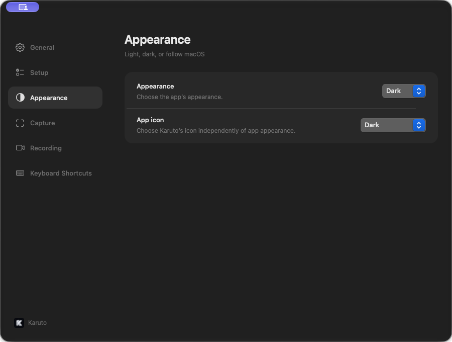

# Karuto

A lightweight, local-first capture utility for macOS. Capture screenshots, record your screen, and stitch scrolling content in browsers or Mac apps. Karuto uses a native Swift/AppKit interface, ScreenCaptureKit, and a small Rust stitching core. No browser extension or cloud account is required.

**Alpha:** Karuto is under active development.

## Screenshots

Current settings screens from the alpha. Shortcuts shown reflect the configuration used for the screenshot and can be customized. Window captures may flatten the glass effect.

| Appearance settings | Keyboard shortcuts |
| --- | --- |
|  |  |

## Features

- **Screenshots:** capture an area, display, or window as PNG; use a three-second timer, repeat a previous area, and optionally include window shadows.
- **Area suggestions:** hover over a window in Area mode for a dashed outline, then click to select its bounds. Scrolling mode suggests the accessible scrolling pane under the pointer when available and labels window-bounds fallbacks. Drag instead to draw a custom rectangle.
- **Adjust or capture instantly:** release the mouse to capture an area immediately, or disable Instant Capture to move and resize the selection before pressing Return.
- **Freeze the display:** select from a still image while applications and audio continue running. Choose a persistent default in settings or override it for the current capture session.
- **Screen recording:** record an area, display, or window to H.264 MP4, with cursor, system audio, microphone, and resolution options.
- **Scrolling capture:** automatically scroll through a visible browser or Mac app and stitch overlapping frames locally into a PNG. Initial motion checks can exclude stationary headers, footers, and sidebars; a dashed guide shows the verified moving area. Switch to manual scrolling at any time. Automatic scrolling needs Accessibility access. Unverified or ambiguous areas offer **Adjust Area**; interrupted automation can continue manually. No browser extension is needed.
- **Capture previews:** copy, save, reveal, or trash screenshots; open a capture in its default viewer or drag it to another app. Screenshots copy to the clipboard by default. Previews can persist or disappear after a configurable delay. Moving away after hovering waits 0.5 seconds before fading out; returning during that delay or fade restores the preview.
- **Custom shortcuts:** configure app, global, and capture shortcuts in Settings. Instant Capture and Freeze Display shortcuts are unassigned by default.
- **Setup assistance:** open the required macOS permission pages from Settings → Setup, see current access, and optionally launch Karuto at login with only its menu bar icon visible.
- **Local by design:** captures and stitching run on your Mac. Cloud storage and telemetry are not part of the app.

## Installation

Build from source on **macOS 15 or later**. Install Xcode or the Xcode Command Line Tools, a Rust toolchain with Cargo, and `librsvg` (`rsvg-convert`), then run from the project directory:

```sh
bash scripts/build.sh
open dist/Karuto.app
```

The build script automatically selects an Apple Development signing certificate if exactly one is available. If you have multiple certificates, set `KARUTO_SIGN_IDENTITY` to the SHA-1 fingerprint of the one to use. For a disposable ad-hoc build, use:

```sh
KARUTO_SIGN_IDENTITY=- bash scripts/build.sh
```

Use a consistent signing identity across builds: changed ad-hoc signatures can cause macOS to lose track of previously granted screen-recording permission.

Karuto has a new app identity, so settings and privacy grants from earlier builds do not carry over automatically.

When prompted, allow the app under **System Settings → Privacy & Security → Screen & System Audio Recording**. Restart it if macOS requests it. Microphone permission is requested only when microphone recording is selected. If migrating from an older ad-hoc build, you may need to remove its old permission entry and grant access again.

Open **Settings → Setup** for buttons to Screen & System Audio Recording, Accessibility, and Microphone settings. Screen access is required for capture; Accessibility enables automatic scrolling and pane suggestions; microphone access is optional. The same section has **Launch at login** and a shortcut to macOS Login Items. If macOS requires approval, complete it there. Karuto always opens quietly with only its menu bar icon, whether launched manually or at login. Open capture through its configurable shortcut or **Open Capture Toolbar** in the menu bar menu. Keep the app in a stable location after enabling login launch.

## Getting started

1. Open the app; it stays in the menu bar. Use **Control–Shift–2** or choose **Open Capture Toolbar** from its menu bar menu. Drag anywhere on the toolbar to reposition it.
2. Choose **Area**, then drag over the screen. By default the capture is taken when you release the mouse. With Instant Capture disabled, adjust the selection and press **Return**.
3. Use the toolbar options menu to change Instant Capture or Freeze Display for the current session. Set defaults in Preferences.
4. Open Preferences with **Command–comma**, or Keyboard Shortcuts with **Command–Option–comma**. These shortcuts are configurable. Press **Escape** to reset an active drag or an adjustable area selection; press it again with no selection to close capture. The on-screen Cancel button closes capture directly.

## Alpha limitations

Scrolling capture stitches visible rendered pixels; it cannot capture content that has not loaded or rendered. Accessibility suggestions depend on what the target app exposes and can be broader than the intended pane. Motion verification handles stationary outer edges, but animations, multiple independently moving regions, repeated patterns, and fast scrolling can require a smaller selection. If no additional content is stitched, Karuto reports it rather than saving a single viewport as a scrolling capture. Freeze captures the earliest frames returned after macOS permission and display discovery, rather than an exact keypress timestamp. Frozen window captures include anything covering the visible window; recording, scrolling capture, and the timer remain live.

Editing, markup, OCR, GIF export, webcam overlays, recording pause/resume, and persistent capture history are not yet implemented.

## Command-line interface

Use `scripts/karuto` for noninteractive display and window discovery, scrolling-pane suggestions, screenshots, scrolling captures, and timed recordings. Output is JSON for agents. See the [CLI reference](docs/cli/README.md) for every command, permissions, coordinates, and examples.

## Development

Run the test suite with:

```sh
bash scripts/test.sh
```

See the [architecture](docs/agents/architecture.md), [keymap](docs/keymap.md), [alpha validation](docs/alpha-validation.md), and [memory measurements](docs/memory-performance.md) for implementation and testing details.
