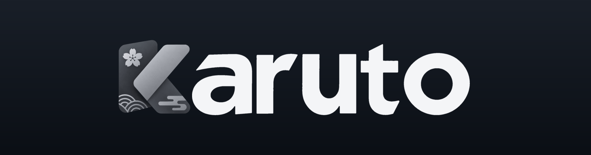
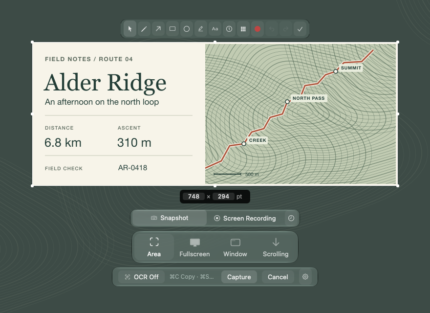
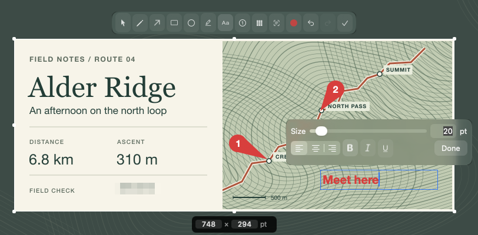
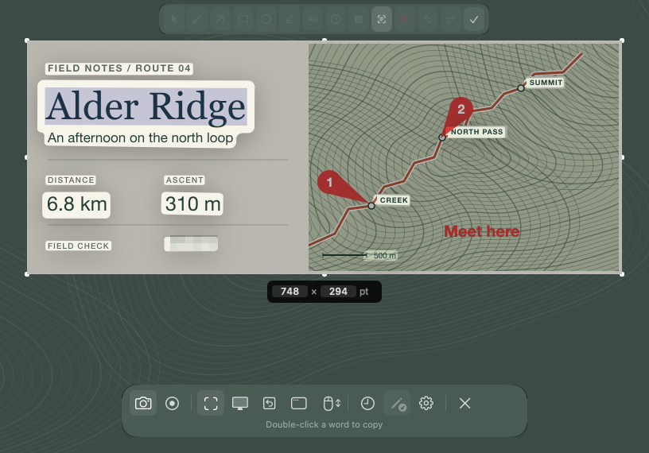
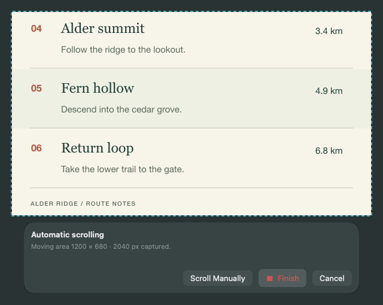
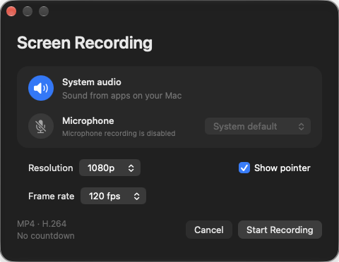
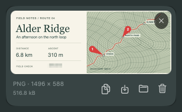
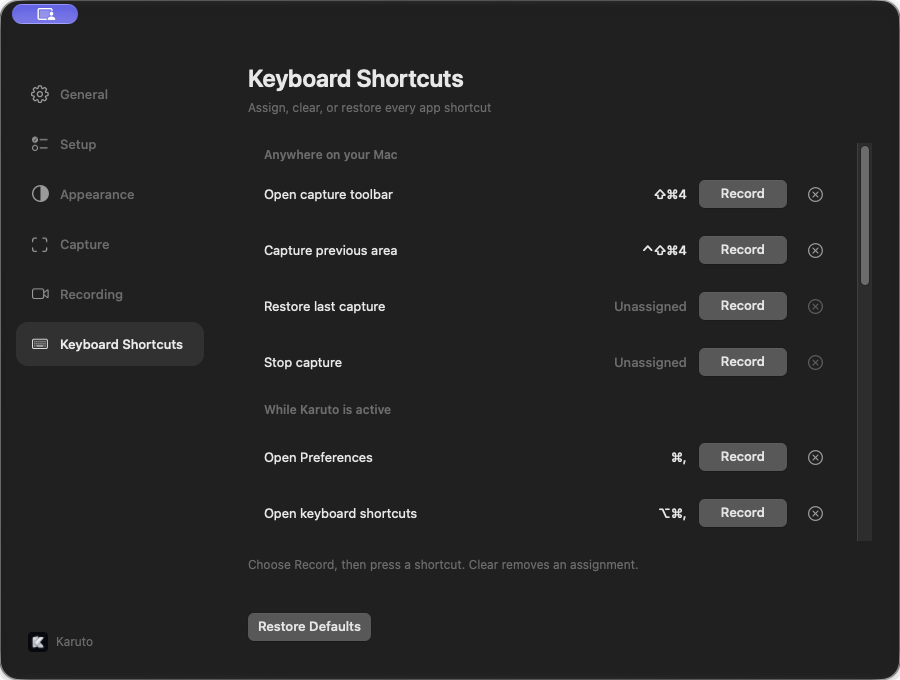

# Karuto

A lightweight, local-first capture utility for macOS. Capture screenshots, record your screen, and stitch scrolling content in browsers or Mac apps. Karuto uses a native Swift/AppKit interface, ScreenCaptureKit, and a small Rust stitching core. No browser extension or cloud account is required.

**Alpha:** Karuto is under active development.

## Features

### Select and capture

Press **Control–Shift–2** to open the toolbar. Capture a window or display, drag out an area, or click a suggested window outline. After you release the mouse, the selection shows its width and height in points. Click either value to resize precisely.



| In the Area overlay | Default shortcut |
| --- | --- |
| Copy the annotated PNG to the clipboard without saving a file | **Command–C** |
| Save the PNG to the configured Save folder | **Command–S** |
| Capture using your usual save and clipboard preferences | **Return** |
| Select the last captured rectangle for adjustment | **Command–R** |

Copy and Save are available with Instant Capture off. Turn **Instant Capture** on to capture on mouse release, or click **Annotate** to keep one selection open for markup. Choose **Freeze Display** to select from a still frame. Snapshot and Screen Recording remember their own region and timer. **Capture Previous Area** can also be assigned a global shortcut to repeat a capture directly.

### Annotate before capture

Draw with the pen, highlighter, arrow, rectangle, or ellipse. Use numbered circles to mark steps and Mosaic to pixelate detail. Drag a text box to move it, resize it by a handle, or double-click to edit its text, size, alignment, and styling. **Escape** finishes text editing and leaves the box selected. **Shift–Return** inserts a line break. Undo and redo with **Command–Z** and **Command–Shift–Z**.



### Copy text directly from the screen

Switch on **OCR** to highlight recognizable text in an area, window, or display. Double-click a word to copy it, drag across a passage and press **Command–C**, or choose **Copy All**. The overlay stays open, so you can copy another passage without taking a screenshot. Requires a Mac with Live Text support.



### Capture a scrolling page

Choose **Scrolling**, select a pane in a browser or Mac app, and let Karuto scroll downward. It checks which content moves, outlines the verified region, and stitches overlapping frames into one PNG. Choose **Scroll Manually** to use your trackpad, mouse wheel, or Up and Down arrow keys. Scroll down to add content, then choose **Finish**. If Karuto can’t verify a single moving pane, choose **Adjust Area**. With macOS Accessibility access, Karuto directs arrow keys to the selected pane and paces fast wheel or trackpad input as frames arrive. Automatic scrolling and pane suggestions also use this access.



[Open the full stitched guide (PNG)](docs/ui-evidence/scrolling-result.png)

### Record the screen

Record an area, window, or display to H.264 MP4. Pick **30, 60, or 120 fps** in Recording settings or before you start. The default is 30 fps. Choose 1080p or native resolution, then select the pointer, system audio, and microphone independently. Completed recordings go to the Save folder.



### Use the capture preview

Copy, save, reveal, or trash a screenshot from its corner preview. Drag a capture into another app or open a recording in your default player. Settings control how long previews stay visible, whether screenshots save automatically, and whether they copy to the clipboard.



### Customize Karuto

Choose an appearance and app icon, assign or clear shortcuts, and configure launch at login. **Settings → Setup** links directly to the macOS permissions Karuto uses. Capture, text recognition, and stitching run locally.

| Appearance | Keyboard shortcuts |
| --- | --- |
| [](docs/ui-evidence/settings-appearance-current.png) | [](docs/ui-evidence/settings-shortcuts-current.png) |

## Credits

Thanks to Alejandro Sirgo Rica and the contributors who build and maintain [Flameshot](https://github.com/flameshot-org/flameshot). Its capture overlay inspired Karuto’s annotation palette, mosaic tool, and shortcuts for copying or saving a selection.

Karuto’s numbered-circle tool adapts the circle and pointer geometry from Flameshot’s [CircleCountTool](https://github.com/flameshot-org/flameshot/blob/dcc3bd3175495e04832c4aac0868f1dd15aba2ca/src/tools/circlecount/circlecounttool.cpp). The app includes the [attribution notice](Resources/Licenses/Flameshot.txt) and [GPL license](Resources/Licenses/Flameshot-GPL-3.0.txt).

The Karuto icon and wordmark were generated independently with ChatGPT, without using external artwork as a reference.

## License

You may use Karuto at home or at work, modify it, and redistribute it under the [GNU General Public License](LICENSE), version 3 or, at your option, any later version (`GPL-3.0-or-later`). You may give away or sell copies. If you distribute a compiled app, you must make its corresponding source, including any changes you made, available to recipients under the GPL.

Karuto is provided as-is, without warranty to the extent permitted by law. Support, updates, and review of contributions are at the maintainers’ discretion.

## Installation

Build from source on **macOS 15 or later**. Install Xcode or the Xcode Command Line Tools, a Rust toolchain with Cargo, and `librsvg` (`rsvg-convert`), then run from the project directory:

```sh
bash scripts/build.sh
open dist/Karuto.app
```

The build script automatically selects an Apple Development signing certificate if exactly one is available. If you have multiple certificates, set `KARUTO_SIGN_IDENTITY` to the SHA-1 fingerprint of the one to use. For a disposable ad-hoc build, use:

```sh
KARUTO_SIGN_IDENTITY=- bash scripts/build.sh
```

Use a consistent signing identity across builds: changed ad-hoc signatures can cause macOS to lose track of previously granted screen-recording permission.

Karuto has a new app identity, so settings and privacy grants from earlier builds do not carry over automatically.

When prompted, allow the app under **System Settings → Privacy & Security → Screen & System Audio Recording**. Restart it if macOS requests it. Microphone permission is requested only when microphone recording is selected. If migrating from an older ad-hoc build, you may need to remove its old permission entry and grant access again.

Open **Settings → Setup** for buttons to Screen & System Audio Recording, Accessibility, and Microphone settings. Screen access is required for capture; Accessibility enables automatic scrolling and pane suggestions; microphone access is optional. The same section has **Launch at login** and a shortcut to macOS Login Items. If macOS requires approval, complete it there. Karuto always opens quietly with only its menu bar icon, whether launched manually or at login. Open capture through its configurable shortcut or **Open Capture Toolbar** in the menu bar menu. Keep the app in a stable location after enabling login launch.

## Getting started

1. Open the app; it stays in the menu bar. Use **Control–Shift–2** or choose **Open Capture Toolbar** from its menu bar menu. Drag anywhere on the toolbar to reposition it.
2. Choose **Area**, then drag over the screen. Release to adjust or annotate the selection. For an exact size, click the width or height at the edge of the rectangle. Values are in points. **Tab** moves between the fields and **Return** applies the edit. Press **Return** outside the fields to capture. With Instant Capture enabled, click **Annotate** first to open the palette for this capture.
3. Use the toolbar options menu to change Instant Capture or Freeze Display for the current session. Set defaults in Preferences.
4. Open Preferences with **Command–comma**, or Keyboard Shortcuts with **Command–Option–comma**. These shortcuts are configurable. Press **Escape** to reset an active drag or an adjustable area selection; press it again with no selection to close capture. The on-screen Cancel button closes capture directly.

## Alpha limitations

Scrolling capture stitches visible rendered pixels; it cannot capture content that has not loaded or rendered. Accessibility suggestions depend on what the target app exposes and can be broader than the intended pane. Motion verification handles stationary outer edges, but animations, multiple independently moving regions, repeated patterns, and fast scrolling can require a smaller selection. If no additional content is stitched, Karuto reports it rather than saving a single viewport as a scrolling capture. Freeze captures the earliest frames returned after macOS permission and display discovery, rather than an exact keypress timestamp. Frozen window captures include anything covering the visible window; recording, scrolling capture, and the timer remain live.

The annotation palette applies to Area snapshots. Mosaic pixelates image detail. Live and delayed snapshots sample the screen at capture time, so moving content can differ from its mosaic preview.

GIF export, webcam overlays, recording pause/resume, and persistent capture history are not yet implemented.

## Command-line interface

Use `scripts/karuto` for noninteractive display and window discovery, scrolling-pane suggestions, screenshots, scrolling captures, and timed recordings. Output is JSON for agents. See the [CLI reference](docs/cli/README.md) for every command, permissions, coordinates, and examples.

## Development

Run the test suite with:

```sh
bash scripts/test.sh
```

See the [architecture](docs/agents/architecture.md), [keymap](docs/keymap.md), [alpha validation](docs/alpha-validation.md), and [memory measurements](docs/memory-performance.md) for implementation and testing details.

When publishing a compiled app, offer the complete source used to build it, including the build scripts, alongside the download. For a release built from an unmodified Git tag, link to that tag’s source archive.
